# Enterprise architecture

Generated from DSL by `highscript diagram`, do not edit. In diagrams:

- rectangles are units with their level, rounded boxes are components; grey parts are not exposed by their unit, dashed parts are declared in DSL without code
- ovals are actors; double-bordered boxes are other parts of the model, drawn at the level where they meet the unit; hexagons are required contracts without a provider
- `==>` is a call through a transport (contract, version, transport), `-->` is a use in process (port name when it differs), `-.->` is the adapter given by `via`; an arrow that crosses the boundary is drawn on the boundary and names the part inside

## Landscape

Enterprise with its parts expanded one level deeper.

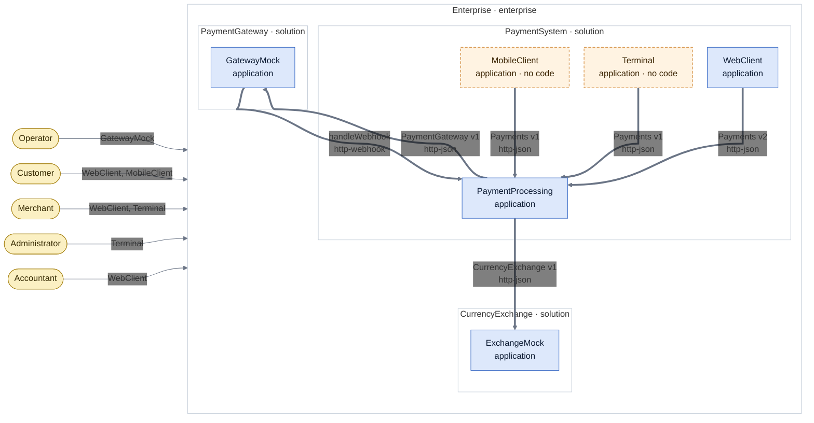

## Enterprise

enterprise, `Enterprise/enterprise.js`

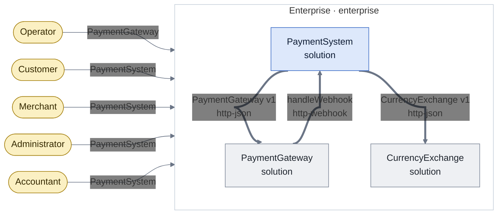

## Enterprise.PaymentSystem

solution, `Enterprise/PaymentSystem/solution.js`

```mermaid
%%{init: {"look":"classic","flowchart":{"curve":"bumpX","nodeSpacing":28,"rankSpacing":56,"padding":14,"look":"classic"},"themeVariables":{"lineColor":"#6b7586","arrowheadColor":"#6b7586","fontFamily":"ui-sans-serif, system-ui, sans-serif","clusterBkg":"transparent","clusterBorder":"#c5ced9","edgeLabelBackground":"transparent","nodeShadow":false,"dropShadow":"none"},"themeCSS":".labelBkg,.edgeLabel span,.edgeLabel p{background-color:var(--bgColor-default,Canvas)!important;}.node rect,.node circle,.node ellipse,.node polygon,.node path,.cluster rect,[data-look=neo].node rect,[data-look=neo].node circle,[data-look=neo].node polygon,[data-look=neo].node path,[data-look=neo].node .outer-path,[data-look=neo].cluster rect{filter:none !important;}"}}%%
flowchart LR
  v2_actor_Accountant(["Accountant"]):::actor
  v2_actor_Customer(["Customer"]):::actor
  v2_actor_Merchant(["Merchant"]):::actor
  v2_actor_Administrator(["Administrator"]):::actor
  subgraph v2_Enterprise_PaymentSystem ["PaymentSystem#160;·#160;solution"]
    direction TB
    v2_Enterprise_PaymentSystem_WebClient["WebClient<br/>application"]:::unit
    v2_Enterprise_PaymentSystem_MobileClient["MobileClient<br/>application · no code"]:::missing
    v2_Enterprise_PaymentSystem_Terminal["Terminal<br/>application · no code"]:::missing
    v2_Enterprise_PaymentSystem_PaymentProcessing["PaymentProcessing<br/>application"]:::unit
  end
  v2_Enterprise_PaymentGateway[["PaymentGateway<br/>solution"]]:::external
  v2_Enterprise_CurrencyExchange[["CurrencyExchange<br/>solution"]]:::external
  v2_Enterprise_PaymentGateway ==>|"PaymentProcessing<br/>handleWebhook<br/>http-webhook"| v2_Enterprise_PaymentSystem
  v2_actor_Customer -->|"WebClient, MobileClient"| v2_Enterprise_PaymentSystem
  v2_actor_Merchant -->|"WebClient, Terminal"| v2_Enterprise_PaymentSystem
  v2_actor_Administrator -->|"Terminal"| v2_Enterprise_PaymentSystem
  v2_actor_Accountant -->|"WebClient"| v2_Enterprise_PaymentSystem
  v2_Enterprise_PaymentSystem_MobileClient ==>|"Payments v1<br/>http-json"| v2_Enterprise_PaymentSystem_PaymentProcessing
  v2_Enterprise_PaymentSystem ==>|"PaymentProcessing<br/>PaymentGateway v1<br/>http-json"| v2_Enterprise_PaymentGateway
  v2_Enterprise_PaymentSystem ==>|"PaymentProcessing<br/>CurrencyExchange v1<br/>http-json"| v2_Enterprise_CurrencyExchange
  v2_Enterprise_PaymentSystem_Terminal ==>|"Payments v1<br/>http-json"| v2_Enterprise_PaymentSystem_PaymentProcessing
  v2_Enterprise_PaymentSystem_WebClient ==>|"Payments v2<br/>http-json"| v2_Enterprise_PaymentSystem_PaymentProcessing
  classDef unit fill:#dde8fb,stroke:#3567c4,color:#0d1b33
  classDef component fill:#dcf3e6,stroke:#2b8a57,color:#0c2a1a
  classDef internal fill:#eef0f3,stroke:#7c8697,color:#1d232c
  classDef missing fill:#fff3e2,stroke:#cc7a1f,color:#3a2200,stroke-dasharray:5 3
  classDef actor fill:#fbf0c3,stroke:#a9861a,color:#352900
  classDef external fill:#e4e7ec,stroke:#566070,color:#1d232c
  classDef requirement fill:#f2e5fb,stroke:#8045b8,color:#26103a
```

## Enterprise.PaymentSystem.WebClient

application, `Enterprise/PaymentSystem/WebClient/application.js`

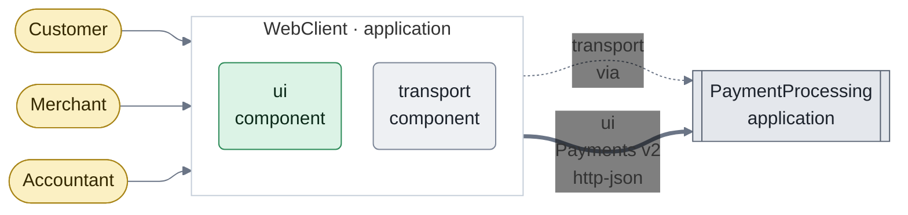

## Enterprise.PaymentSystem.MobileClient

application, `Enterprise/PaymentSystem/MobileClient/application.js`

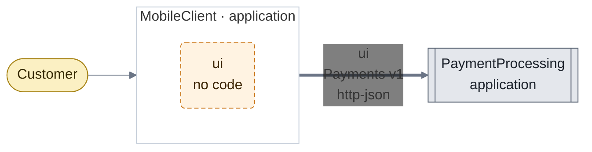

## Enterprise.PaymentSystem.Terminal

application, `Enterprise/PaymentSystem/Terminal/application.js`

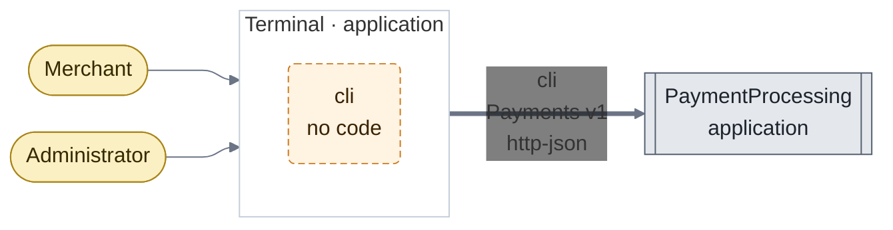

## Enterprise.PaymentSystem.PaymentProcessing

application, `Enterprise/PaymentSystem/PaymentProcessing/application.js`

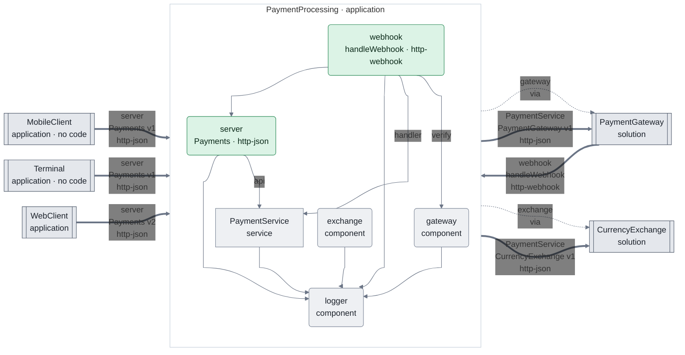

## Enterprise.PaymentSystem.PaymentProcessing.PaymentService

service, `Enterprise/PaymentSystem/PaymentProcessing/PaymentService/service.js`

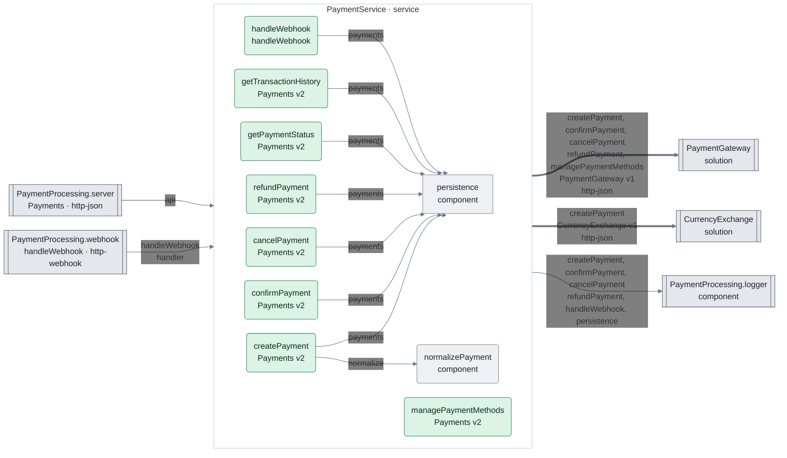

## Enterprise.PaymentSystem.PaymentProcessing.PaymentService.persistence

component, `Enterprise/PaymentSystem/PaymentProcessing/PaymentService/persistence/component.js`

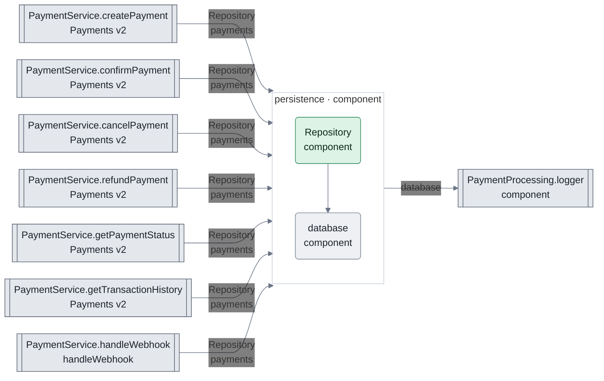

## Enterprise.CurrencyExchange

solution, `Enterprise/CurrencyExchange/solution.md`

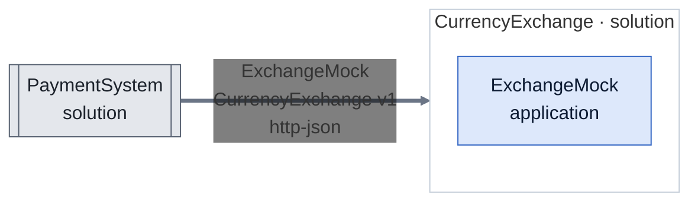

## Enterprise.CurrencyExchange.ExchangeMock

application, `Enterprise/CurrencyExchange/ExchangeMock/application.md`

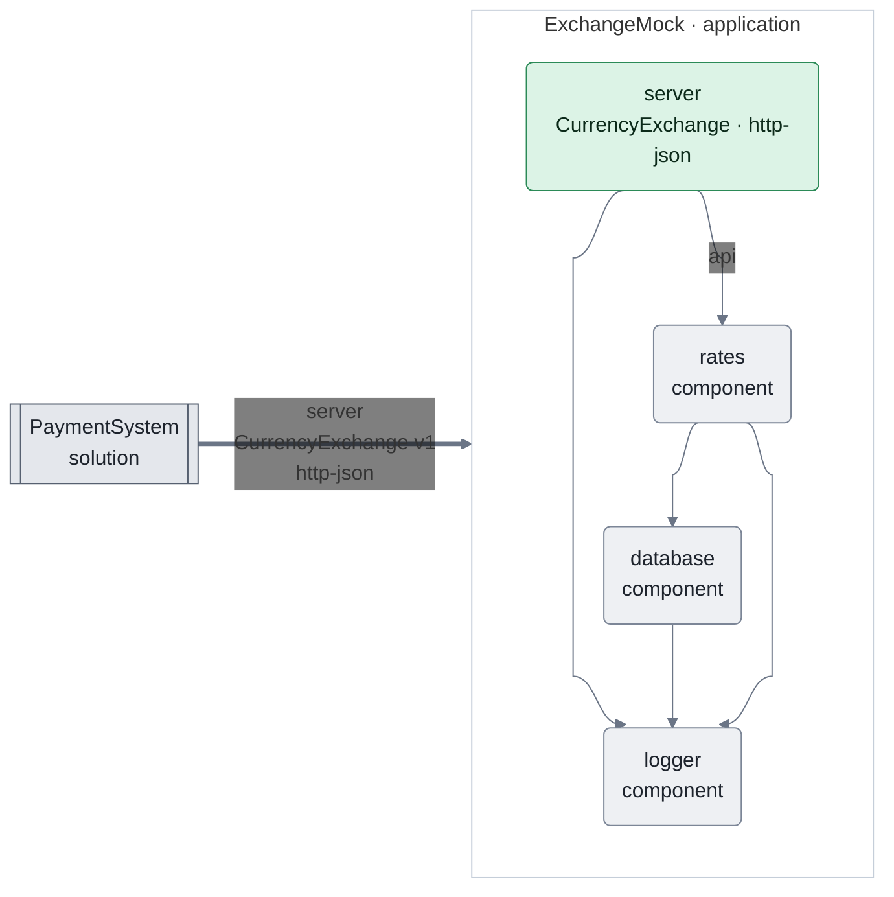

## Enterprise.PaymentGateway

solution, `Enterprise/PaymentGateway/solution.lisp`

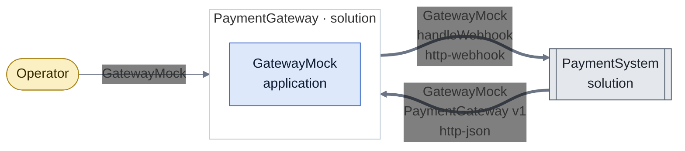

## Enterprise.PaymentGateway.GatewayMock

application, `Enterprise/PaymentGateway/GatewayMock/application.lisp`

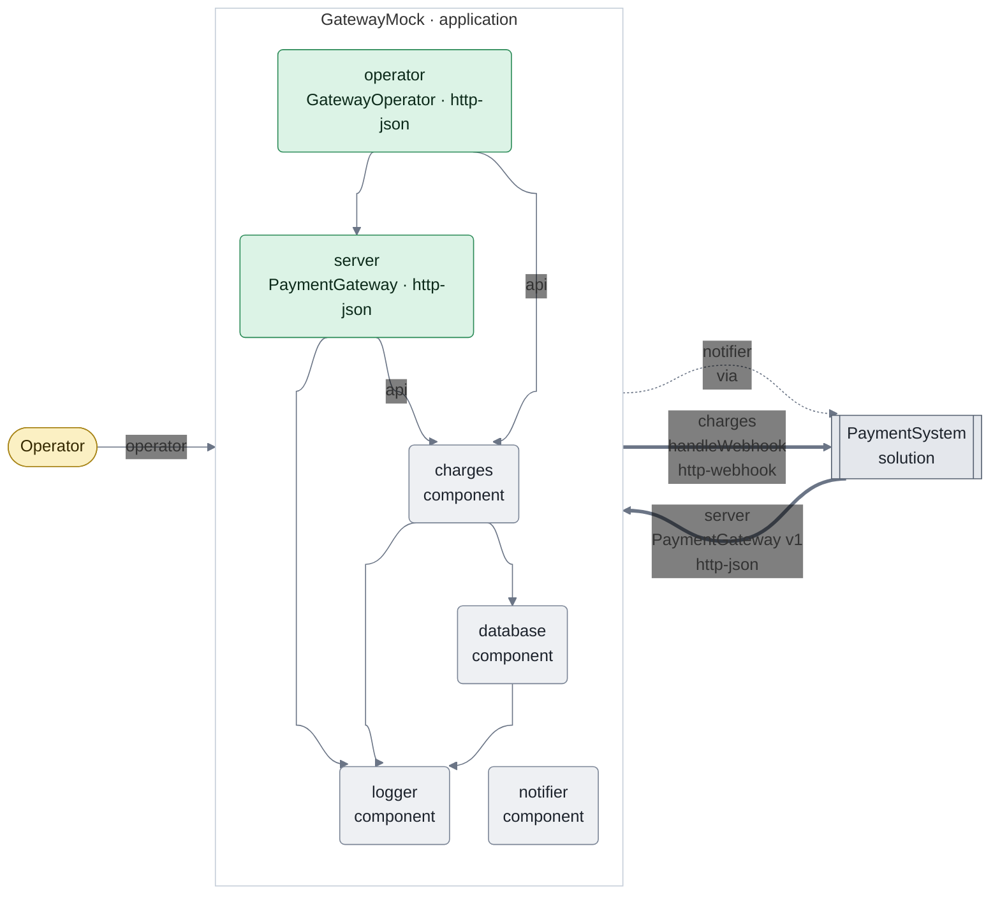
